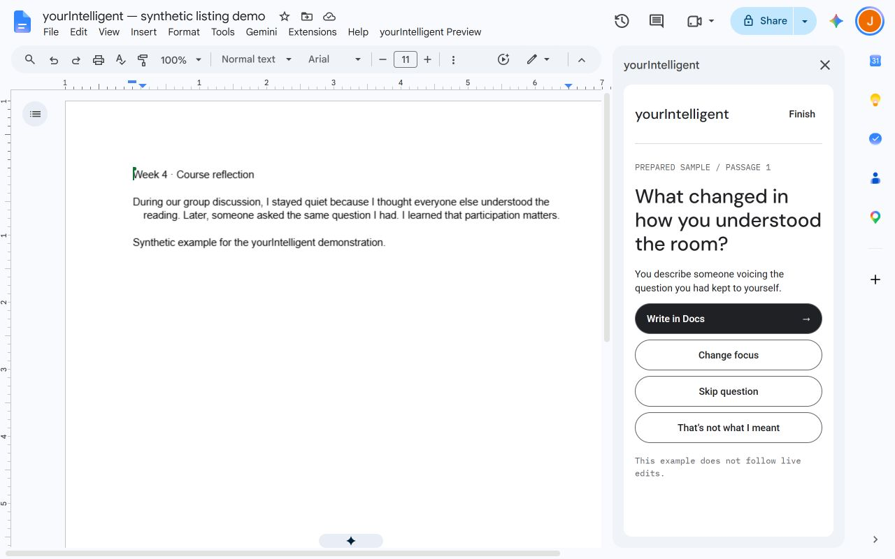

# yourIntelligent: keeping revision decisions with the writer

Working portfolio draft · John Phillip Custodio · November 9, 2026

**A Google Docs revision partner that gives university students one observation and one question, while leaving assignment prose and revision decisions with the student.**

Status: working developer-tested add-on. Founder-reported live integration succeeds with Gemini. Public launch and student evaluation are not complete.

## The design question

Students can use AI to revise personal essays and course reflections quickly. The founder's concern was that handing over the prose might also hand over the reasoning and leave students less connected to their writing. That concern shaped a product hypothesis: useful feedback could support revision without requiring AI-written replacement prose.

The initial audience is university students taking English or other reflection-heavy courses. There is no evidence yet that the problem is common across this audience or that students prefer this approach to automation. Those are research questions, not established findings.

## Research informed the questions, not the outcome claims

The desk research examined a confidence-alignment experiment, a conversational-agent mental-health review and lecture notes about helping AI and perceived contribution. The experiment concerned numerical judgments, not writing ownership; the review concerned varied mental-health interventions, not this product. Neither establishes that a writing coach improves authorship, confidence or well-being.

The useful design implication was to make AI interpretations inspectable and contestable. A question can still steer an argument. Having students type the words does not by itself establish agency. The [research synthesis](UX-RESEARCH-SYNTHESIS.md) preserves the source findings, limits and assumptions.

## Three decisions define the product

**Start with an existing passage.** Students select their own text. The sidebar shows an exact local preview, so they can inspect what the AI will receive. There is no whole-document fallback.

**Constrain the AI's role.** Students choose clarity, depth, voice or their own focus. The AI returns one observation and one question, with an optional exact quotation. Students may disagree, redirect, skip or finish. No answer to the AI is required.

**Keep revision in the document.** Students write directly in Docs, then refresh the selected passage locally. A second explicit reading assesses only that refreshed passage. It does not send a prior draft or claim improvement through an automated comparison.

## The complete journey

Select → inspect preview → choose focus → explicitly send → evaluate feedback → revise in Docs → refresh locally → explicitly request a second reading → continue or finish.

The prepared sample is visibly labeled and makes no live AI request. A failed real request never silently becomes sample feedback. Keys remain in sidebar-session memory; the release uses a student-supplied Gemini key. This reduces publisher API spending but adds setup friction and does not eliminate student API costs or provider processing.

## Visual direction

The design moved from a warm editorial-zine exploration toward the light **Margin / Cut** concept. The product name remains yourIntelligent. Near-white and white surfaces, charcoal pill actions, restrained blue accents and compact typography suit the narrow Docs margin. DM Sans headings, Roboto body text and IBM Plex Mono metadata differentiate question, explanation and state.

The aim is a quiet, approachable writing partner rather than an authoritative grader. [Figma source](https://www.figma.com/design/cCYBiEtcT6Ex7aplARb4Vy/yourIntelligent?node-id=5-12659). Visual fidelity, accessibility and perceived tone still need systematic host review.

## Building through the real integration boundary

The implementation uses TypeScript, esbuild and Apps Script with a bundled HTML sidebar. The server provides selected-text capture and a fixed Gemini request adapter; it exposes no document-writing operation. Strict request fields exclude prior drafts, output validation checks structure and exact quotation grounding, and a bounded nonce ledger prevents duplicate submission of the same request ID. There is no automatic model retry.

The first integration obstacle was authorization failures that differed between browser and script contexts. A minimal document-bound probe isolated a working connection. Native top-level Apps Script entry points and support for full-paragraph selections enabled the real capture path. The founder subsequently confirmed the standalone add-on test worked. These observations explain the debugging direction; they do not prove a universal low-level cause for every earlier authorization failure.

A separate Aion Labs build exercised the synthetic test loop before Gemini verification. Aion remains test-only. Provider-specific processing and credentials are kept explicit rather than treated as interchangeable.

## Evidence so far

| Evidence | What it establishes | Limit |
|---|---|---|
| 31 automated tests plus strict typecheck/build | Selection logic, request/output boundaries, duplicate suppression, late-result handling, writing-focus preservation and explicit refreshed-only sends in deterministic checks | Not live host or broad model-quality coverage |
| Founder-confirmed Aion full loop | Capture, first reading, manual revision, local refresh and refreshed-only second reading in bound preview | Synthetic development test; not the release provider |
| Founder-confirmed Gemini full loop | The same revision sequence works with the shipping provider in bound preview | Not student outcome evidence |
| Founder-confirmed standalone capture + Gemini reading | Core flow also runs through an Editor add-on test deployment | Not public installation or full standalone edge-case coverage |

## What remains before launch

Host edge cases and accessibility, broader synthetic coaching evaluation, provider data-use alignment, remaining OAuth/Marketplace reviews and independent-account installation. A store listing with assets and synthetic screenshot is saved as a draft, not submitted. The [product and policy/support website](https://johnsampangcustodio.github.io/yourIntelligent/) is live on GitHub Pages; this is separate from public add-on availability. Public-release status must stay explicit until a real listing exists and a second account can use it.

The next research stage is voluntary student use with recent reflection drafts: do students understand and endorse their revision choices, can they reject unhelpful questions, and is the extra effort worthwhile? Faster completion, ownership, learning and enjoyment are separate outcomes to investigate. No student findings or psychological benefits are claimed yet.

## Portfolio completion notes

The November 9 design implementation replaces the flat MVP layout with Margin / Cut region hierarchy, compact status pills, readable light-showcase controls and paired actions. The question stays visible while writing, and a refreshed passage gets its own unsent preview. Shorter task copy removes repeated guidance. Motion is limited to brief action/selection feedback and state entrances, with reduced-motion overrides. A request finishing in the background offers View reading without taking the student out of writing. See [design evidence](docs/design-refresh/README.md) for the actual standalone Docs screenshot and verification limits. No improved usability or agency is claimed from visual polish alone.

This draft is editable source, not a finished visual portfolio. Add real synthetic-content screenshots of passage preview, grounded feedback and refreshed reading; a concise Figma-to-host comparison; the public installation link when verified; and founder-reviewed role/decision captions. Do not use staged model feedback as a claimed live result. See [release package](docs/RELEASE-PACKAGE.md) for remaining delivery gates.

## Real host image

Captured from the real bound development preview in a separate synthetic document. The feedback is visibly a prepared sample, not a claimed live model response. Founder-reported live Gemini acceptance is documented separately. This image does not establish public installation or student outcomes.
