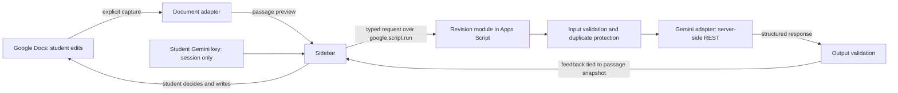

# yourIntelligent: development plan

Execution sequence, milestone gates, ownership, and delivery tracking are in [ORCHESTRATOR-PLAN.md](ORCHESTRATOR-PLAN.md).

November 7, 2026 | Software engineering plan | Status: ready for implementation

## 1. Scope and source of truth

Implement the revision-first experience in [PRODUCT-PLAN.md](PRODUCT-PLAN.md), especially sections 5-10 (tasks, core services, interaction, first release, states, and R1-R10), section 14 (deliverables), and section 15 (solo sequence).

**Confirmed engineering constraints**

- Solo developer, assisted by Codex; prioritize the shortest path to a complete useful revision loop.
- Public distribution to students using their own Google accounts.
- Students provide **Google Gemini API keys**. No developer-funded model account.
- Developer spending target: **$0**. Use Apps Script hosting, local development tools, and no paid infrastructure by default.
- Students write all assignment prose; AI supplies questions and feedback.
- User evaluation comes later. Technical verification is part of implementation.

This document specifies work to build. It does not claim an application, Google deployment, credentials, or passing software tests already exist. Current repository contents are planning/research artifacts. Node v22.21.0, npm 10.9.4, Git, and Python were found in the local environment; no app dependencies were installed for this plan.

## 2. First engineering milestone

In a real Google Doc:

1. Open yourIntelligent's sidebar.
2. Enter a Gemini key for this sidebar session.
3. Select a student-written passage and preview exactly what will be used.
4. Choose **Find the thread**, **Go a layer deeper**, **Keep it me**, or a custom focus.
5. Request one specific observation and one question.
6. Revise manually in Docs.
7. Refresh the selected passage for another reading, redirect, or finish.

The first milestone is the complete loop with one lens and real Gemini feedback; the next slice completes all lenses and recovery states. A browser mockup alone does not satisfy this milestone.

## 3. Stack decisions

| Layer | Proposed choice | Reason |
|---|---|---|
| Product integration | Google Docs **Editor add-on**, desktop | Fits the sidebar and selected-passage workflow in product sections 8-11 |
| Language | TypeScript, strict type checking | Share contracts and catch mistakes before upload |
| Sidebar | Semantic HTML, plain CSS with design tokens, TypeScript | Small stateful interface; direct control without a larger application framework |
| Server runtime | Google Apps Script V8 | Document access, authenticated sidebar calls, hosting, and server-side Gemini requests in one project |
| Provider transport | Gemini REST through `UrlFetchApp` | Avoid assuming a Node SDK will run inside Apps Script |
| AI output | JSON Schema plus runtime validation | Predictable observation/question card; reject malformed or ungrounded output |
| Build | esbuild plus a small Node build script | Produce Apps Script-compatible JavaScript and self-contained sidebar HTML |
| Upload/versioning | Project-local `@google/clasp` | Keep source in Git; upload only generated output |
| Package management | npm with committed lockfile | Available locally; reproducible dependency installation |
| Verification | TypeScript + Vitest; browser checks for sidebar; real Docs integration checklist | Verify the important seams rather than mirror every function |
| Persistence | Sidebar memory for content/keys; minimal User Properties metadata if needed | No database or saved draft history required by first-release scope |
| Diagnostics | Sanitized Apps Script logs | Track failures without keys or personal writing |
| Public supporting pages | Static help/privacy/support pages on a suitable no-cost host | Public launch documentation without a separate app backend; verify ownership/review suitability |

The initial application has one repository, one Apps Script runtime, and one real provider. There is no separate web application, database, payment system, or custom API server in this scope. If later scale or key-management requirements demand another runtime, record that decision rather than adding one preemptively.

Google's current `clasp` no longer transpiles TypeScript. Build locally before uploading. Apps Script's HTML-to-server communication is asynchronous and can complete out of order. These are verified platform constraints, not optional implementation details. [clasp](https://github.com/google/clasp), [sidebar communication](https://developers.google.com/apps-script/guides/html/communication).

Apps Script HTML interfaces run in a sandboxed iframe. Package the sidebar's scripts/styles with the build and verify its actual rendering in Docs. [HTML-service restrictions](https://developers.google.com/apps-script/guides/html/restrictions).

## 4. Architecture and module responsibilities



The final arrow is a human action. There is no model-driven document-write path.

### Modules and seams

| Module | Interface / responsibility | Actual variation |
|---|---|---|
| Document adapter | Capture supported selected text, active document/tab reference, and a fingerprint; expose no writing method | Actual Apps Script selection vs synthetic test fixtures |
| Sidebar state | Own passage snapshot, focus, in-flight request, feedback, and temporary key | Live bridge vs local mock bridge |
| Revision module | Validate one coaching/review request, construct instructions, call provider, check result, map errors | Real Gemini adapter vs deterministic fake |
| Gemini adapter | One bounded text-generation request using the supplied key | Real REST vs provider-response fixtures |
| Request guard | Prevent overlapping/repeated intents for the current user | Apps Script metadata store vs in-memory test store |

Keep these interfaces small. Provider details stay inside the Gemini adapter; Google document details stay inside the document adapter. A second provider is not implemented now.

## 5. Proposed repository and build

```text
PRODUCT-PLAN.md
DEVELOPMENT-PLAN.md
src/
  shared/
    contracts.ts
    validation.ts
  sidebar/
    index.html
    styles.css
    main.ts
    state.ts
    bridge.ts
  server/
    entry.ts
    document.ts
    revision.ts
    gemini.ts
    request-guard.ts
    errors.ts
  dev/
    mock-bridge.ts
    fixtures.ts
scripts/
  build.mjs
  dev.mjs
tests/
  selection.test.ts
  revision.test.ts
  state.test.ts
  request-guard.test.ts
  fixtures/
docs/
  integration-checklist.md
  release-checklist.md
  data-handling.md
  case-study-notes.md
public/
  privacy.html
  support.html
appsscript.json
package.json
package-lock.json
tsconfig.json
dist/                  # generated; not edited by hand
```

Build the server as an IIFE with an explicit namespace, then append top-level Apps Script wrappers for lifecycle/menu and RPC entry points. Keep wrappers visible after bundling; an exported TypeScript function hidden inside a bundle is not automatically a callable Apps Script entry point. Inline trusted compiled sidebar JS/CSS into the generated HTML, never student/provider text into executable markup. Use esbuild's documented IIFE/global-name support. [esbuild](https://esbuild.github.io/api/#global-name).

Only generated `.js`/`.html` and the manifest are uploaded from `dist/`. Ignore dependency directories, credentials, local environment files, and generated artifacts. Pin dependency versions at scaffold time after checking their supported Node versions; do not depend on an unpinned global `clasp`.

### Planned developer commands

| Command | Intended behavior |
|---|---|
| `npm run dev` | Local sidebar preview with synthetic content and deterministic feedback; no model calls |
| `npm run typecheck` | Check browser/shared and Apps Script code with appropriate libraries |
| `npm test` | Run meaningful deterministic tests |
| `npm run build` | Generate Apps Script files and sidebar HTML |
| `npm run check` | Typecheck, tests, build, and artifact validation |
| `npm run push:dev` | Upload the checked build to the explicitly configured development script |

These commands are planned interfaces, not scripts that exist yet. Authenticate `clasp` interactively with the intended publisher account when configuring the development project. Never commit or print its OAuth credential files.

## 6. Google Docs integration

Create a standalone Editor add-on project, then use an Editor add-on test deployment on a synthetic document. Do not use the different card-based Workspace add-on test instructions. Google provides specific Editor add-on test configurations and authorization states. [Build Editor add-ons](https://developers.google.com/workspace/add-ons/how-tos/building-editor-addons), [test Editor add-ons](https://developers.google.com/workspace/add-ons/how-tos/testing-editor-addons).

### Capture behavior

- Read only on **Use selected passage** or **Refresh passage**.
- Handle empty selection with an actionable message; never silently use the whole document.
- Honor partial text offsets, including inclusive end offsets; preserve paragraph separation and Unicode.
- Initially support ordinary text paragraphs/list items. Detect unsupported image/table/mixed selections and explain how to choose a supported passage rather than inventing or silently dropping content.
- Keep document/tab identifiers local to the app integration; exclude them from the Gemini payload.
- Return the exact preview plus a content fingerprint. Feedback is explicitly attached to this captured version.
- Editing the document does not automatically refresh context. A new capture invalidates the prior request/display generation; compare IDs before showing results. Do not claim live monitoring of document changes.

Use the active document/tab and `RangeElement` APIs rather than assuming a selection always covers a whole paragraph. [Document reference](https://developers.google.com/apps-script/reference/document/document#getSelection()), [RangeElement](https://developers.google.com/apps-script/reference/document/range-element).

### Authorization

Proposed manifest scopes: `documents.currentonly`, `script.container.ui`, and `script.external_request`, using their full Google scope URLs in implementation. Confirm the final set against the actual functions and deployment. No broad Drive, Gmail, or email-identity access is planned.

The current-document scope is not a read-only technical permission. Reading only is enforced by implementation: the document adapter has no write operations. On-open/install lifecycle handling must respect authorization modes; opening a document must not trigger Gemini requests or unauthorized document reads. [Editor scopes](https://developers.google.com/workspace/add-ons/concepts/editor-scopes), [authorization lifecycle](https://developers.google.com/workspace/add-ons/concepts/editor-auth-lifecycle).

## 7. Contract-first request/response design

Use plain JSON-serializable objects across `google.script.run`; no Date objects, DOM elements, or class instances. Wrap expected domain failures consistently. Unexpected transport exceptions map to the same sidebar error vocabulary. Internal helper functions are not exported as client-callable RPC functions.

### Application request

```ts
type Focus = "CLARITY" | "DEPTH" | "VOICE" | "CUSTOM";

type RevisionRequest = {
  requestId: string;
  passage: {
    text: string;
    fingerprint: string;
    documentId: string;
    tabId: string;
  };
  focus: Focus;
  customFocus?: string;
  assignmentContext?: string;
  studentIntent?: string;
  mode: "COACH" | "REVIEW";
};

type Feedback = {
  observation: string;
  question: string;
  evidenceQuote: string | null;
};

type RevisionResult =
  | { ok: true; requestId: string; fingerprint: string; feedback: Feedback }
  | { ok: false; requestId: string; error: {
      code: string; message: string; canRetry: boolean;
    }};
```

The key is a separate transient credential argument, not part of persisted request state, diagnostics, fingerprints, or fixtures. The server echoes request identity and fingerprint from its validated inputs, never from model output.

Provisional limits: passage up to 6,000 characters, assignment context up to 2,000, student intent/custom focus up to 500 each. These are product limits for the first selected-passage experience, not platform maximums. Show a clear message instead of silently truncating. Keep model output short and set a bounded output-token budget, calibrated during the spike.

Validate incoming input and external provider output. Require nonempty, bounded observation/question strings; validate any evidence quote as an exact substring of supplied text. Reject extra fields or a malformed response. Use safe text rendering, not model-supplied HTML or Markdown execution.

### Error vocabulary

`NO_SELECTION`, `UNSUPPORTED_SELECTION`, `CONTEXT_TOO_LONG`, `INVALID_REQUEST`, `KEY_REQUIRED`, `INVALID_KEY`, `MODEL_UNAVAILABLE`, `PROVIDER_LIMIT`, `PROVIDER_TIMEOUT`, `INVALID_OUTPUT`, `REQUEST_IN_PROGRESS`, `REQUEST_ALREADY_USED`, `UNKNOWN_OUTCOME`, `AUTH_REQUIRED`, and `INTERNAL_ERROR`.

Never forward a raw provider error, stack trace, request headers, or input payload to logs/UI. A provider failure does not block ordinary Docs editing.

## 8. Gemini implementation

Use the currently documented Gemini Interactions REST endpoint through Apps Script. At planning time Google's text-generation guide demonstrates `gemini-3.8-flash` and the API revision header `2026-05-20`; keep endpoint/revision/model configuration inside the adapter and verify availability with the user's selected account before locking the release. Do not silently switch to an unknown or more expensive model if it is unavailable. [Text generation](https://ai.google.dev/gemini-api/docs/text-generation.md.txt).

Send the supplied key in `x-goog-api-key`, never in a URL. Request a JSON observation/question response, with `store: false`, no provider conversation continuation, no streaming, no tools, and an output-token ceiling. Parse the actual REST `steps`/model-output content; do not assume SDK convenience properties exist in raw HTTP JSON. Re-specify coaching instructions on each request. [Structured output](https://ai.google.dev/gemini-api/docs/structured-output.md.txt), [Interactions reference](https://ai.google.dev/static/api/interactions.md.txt).

The instructions must enforce the product's coaching role: one observation and question, no finished essay passage, no invented experience or diagnosis, no demand for intimate disclosure, and room for the student to disagree. Treat passage and assignment content as untrusted material to discuss, not instructions overriding that role.

Schema validity does not establish good feedback or prevent every rewrite. Combine a constrained format, content checks for obvious drafting, and a small synthetic evaluation corpus. Suppress invalid output with a recoverable message. Do not add a second model call to every request merely to judge the first.

Use `UrlFetchApp` with a configured request deadline and HTTP error handling; its current reference includes `timeoutSeconds`. Confirm that the actual runtime accepts this option during the spike. Exceeding a deadline or closing the sidebar does not prove the provider stopped processing. [UrlFetchApp](https://developers.google.com/apps-script/reference/url-fetch/url-fetch-app).

## 9. BYOK, data handling, and $0 developer cost

### Credential lifecycle

1. Student enters a key in a masked input. We do not request keys in chat.
2. Keep it in sidebar memory only for the current open instance.
3. Send it transiently to Apps Script for the explicit Gemini request.
4. Apps Script uses it server-side and does not persist or return it.
5. **Forget key** removes the application's retained references; closing/reloading the sidebar requires re-entry. This is not a claim of cryptographic memory erasure or cancellation of an in-flight request.

Do not embed a publisher key, save student keys in Script/User/Document Properties, browser localStorage, documents, analytics, or logs. Do not assume user-provided keys are safe to log because they are not the developer's. The key must briefly exist in the entry UI and server execution; the design avoids distributing a shared key or making persistent copies. [Gemini key guidance](https://ai.google.dev/gemini-api/docs/api-key.md.txt).

### Content lifecycle

Use selected text, optional context, and optional intent only. No whole-document scanning, database, persisted chat, or draft-history storage. The sidebar retains the current captured passage and feedback while open; server execution handles them transiently. Diagnostic events contain only release/prompt versions, status/error category, and timing, not document content or credentials.

Gemini still processes the content. `store: false` is not a universal no-retention/no-training promise. Google's unpaid-service terms describe content use for product improvement and human review and tell users not to submit sensitive/confidential/personal information; applicable tier/region rules differ. Provide a truthful link and explanation at key setup and context preview. Do not imply that BYOK or a free tier makes personal reflections private. Verify these details before release. [Gemini terms](https://ai.google.dev/gemini-api/terms).

### Costs

- No developer Gemini key or subsidized requests.
- No separate paid hosting, database, or credential vault in the first implementation.
- Local preview, deterministic tests, and synthetic fixtures make no model calls.
- Students use their own Gemini project quota/billing. Free access is not guaranteed for every account/model/region, and the application must not automatically enable billing or switch to a paid fallback.
- Use Google infrastructure within its actual quotas; a quota limit becomes a recoverable error. Publication/account/domain requirements must be checked against the chosen $0 route before asserting public launch is cost-free. No spending is authorized by this plan.

BYOK changes onboarding: the first release serves students able to obtain and use a Gemini key. This is a real adoption tradeoff to document in the case study, not a hidden implementation detail.

## 10. Asynchronous behavior, duplicate requests, and limits

The client permits one in-flight request per sidebar. Changing passage/focus, forgetting the key, or ending the session invalidates the display generation. A late result can only render if its request ID and passage fingerprint match current state.

Prevent duplicate provider calls with a short-lived per-user request record and a `UserLock` around claim/update. Store only nonce, payload digest, timestamps, and status in a bounded User Properties ledger; never store keys, passage text, or feedback. Prune expired records and enforce ledger capacity instead of silently evicting a still-valid intent. The same request ID with another payload is invalid. An in-flight/completed/unknown duplicate is rejected, not sent again. Clearly define the validity and retention window together when implementing.

Release the lock before the network call, then record completion/failure afterward. Timeouts retain an unknown outcome; there is no automatic provider retry. A user can choose a new attempt with a new ID, understanding it may consume quota again. Do not claim exactly-once billing or a replayable response cache. [LockService](https://developers.google.com/apps-script/reference/lock/lock-service), [Properties Service](https://developers.google.com/apps-script/guides/properties).

Apps Script quota values can change. Keep requests small and single-turn, measure latency in the actual Editor add-on, and avoid designing to a theoretical maximum execution duration. [Apps Script quotas](https://developers.google.com/apps-script/guides/services/quotas).

## 11. Traceability to the product plan

| Product requirement | Engineering implementation | Verification |
|---|---|---|
| R1: student contribution first | No generation request without selected student text or an explicitly labeled synthetic sample | Empty input test and real Docs empty-selection check |
| R2: control context | Explicit capture, exact preview, optional context, no automatic whole-document capture | Partial-selection fixtures and outgoing-request inspection |
| R3: scoped feedback | Focus enum/custom focus, prompt policy, observation/question schema | Synthetic prompt/output corpus |
| R4: usable agency | Redirect, another angle, custom focus, stop; no mandatory response | Sidebar state checks and keyboard walkthrough |
| R5: student-written prose | Read-only document adapter by design; no insert/replace UI or server interface | Adapter/code review, before/after synthetic document check |
| R6: contestable feedback | Observation framing and student-intent correction | Review synthetic agreement/disagreement cases |
| R7: clear context | Snapshot/fingerprint, explicit refresh, request-generation matching | Delayed/out-of-order response test |
| R8: failure preserves writing | Recoverable errors; no editor-blocking dialogs or modifications | Key failure, quota, timeout, and provider-error scenarios |
| R9: deliberate data handling | Session-only key/content, redacted diagnostics, explicit provider disclosure | No secret/content persistence checks; second-account isolation |
| R10: optional completion | Close/stop works in every interaction state | Sidebar interaction check; no completion gate |

These checks establish implementation behavior, not psychological ownership or learning benefits. Those remain in the deferred user evaluation.

## 12. Development backlog and milestone gates

Implement in vertical slices: make one real interaction work, then broaden it.

| Ticket | Work and concrete output | Depends on | Done when |
|---|---|---|---|
| DEV-01 | Scaffold npm/TypeScript/esbuild/clasp build; mock sidebar; shared contracts | None | `npm run check` builds an uploadable artifact; top-level wrappers survive bundling |
| DEV-02 | Standalone Apps Script setup, menu/sidebar, authorization handling | DEV-01; publisher login | Sidebar opens in a real Editor add-on test deployment without reading text on open |
| DEV-03 | Selected-passage adapter and preview | DEV-02 | Ordinary/partial/Unicode selections match preview; no selection is handled; active tabs verified |
| DEV-04 | Session-only Gemini key input, server adapter, one focus, initial request guard and error redaction | DEV-03; an authorized test key | One real selection returns validated observation/question; duplicate calls are guarded; no key in artifacts/logs |
| DEV-05 | Manual revision and refreshed review loop | DEV-04 | Student edits Docs, explicitly refreshes text, and gets feedback attached to the correct version |
| DEV-06 | All focus choices, custom intent, playful copy, accessible states | DEV-05 | Complete product loop including redirect/stop works by keyboard |
| DEV-07 | Complete failure handling, nonce-ledger lifecycle, output checks, and diagnostic redaction | DEV-06 | Duplicate/late/error responses handled across all states; no raw provider messages leak |
| DEV-08 | Integration and provider regression pass; data/help pages; case-study evidence | DEV-07 | Technical checklist complete with synthetic material and a second Google account |
| DEV-09 | Public publication preparation and submission | DEV-08; later evaluation/release decision | Correct scopes, publisher setup, public supporting pages, version and listing package ready |
| DEV-10 | Address review feedback, verify public install, finish case study | DEV-09; external review | Installable version works outside developer test deployment; documented actual result |

First tangible deliverable: **DEV-01 through DEV-05**, one real revision loop. All three lenses and visual polish follow it. Live calls require the test user's configured key; mocks do not prove the Gemini integration works.

Keep DEV-07's basic request guard and sanitization in the first live slice, rather than retrofitting after users or credentials are involved. If the Docs spike fails, resolve that integration before polishing more screens.

## 13. Verification plan

### Deterministic checks

- Partial text extraction and paragraph joining, including emoji and accented text.
- Empty/unsupported/oversized context yields an actionable error.
- A stale response cannot replace feedback for a new passage/focus.
- Malformed JSON, mismatched evidence quotes, extra fields, refusal, or incomplete generation is handled.
- Duplicate claims race safely and an unknown outcome does not trigger a hidden retry.
- Keys and student text do not enter persistent state or captured diagnostic output.

### Real-platform checks

- Google authorization, no-permission behavior, menu creation, and sidebar focus/selection behavior.
- Multiple Docs tabs and two documents; no cross-context feedback display.
- Student can keep writing during pending/error states; no document content is automatically changed.
- A second Google account cannot see another user's transient context/credentials.
- Invalid/revoked key, unavailable model, quota response, and timeout recover without losing the writing task.
- Keyboard focus, readable sidebar layout, loading/error announcements, and reduced motion.

### Model behavior checks

Use synthetic reflection passages representing clarity, depth, voice, disagreement, embedded instructions, requests for rewrites, and ordinary/non-intimate experiences. Assess whether feedback is grounded, useful in form, and within the coaching role. Save synthetic fixtures and prompt version; do not store student reflections as test data. Technical/model checks happen before release even while user research is deferred.

## 14. Release and operations

Use separate development and publication Apps Script projects/configuration. Publish an immutable version; preserve the previous working version and record which Git commit produced each release. A failed release can be replaced by the prior artifact/version, while retained scopes/configuration changes need their own review.

Public Marketplace distribution requires Google's review. The publishing guide describes a standard Cloud project, versioning, and a permanent public/private visibility choice; OAuth verification depends on the scopes. Do not confuse a test deployment or domain-private listing with public student installation. [Publishing](https://developers.google.com/workspace/add-ons/how-tos/publish-add-on-overview), [scope verification](https://developers.google.com/workspace/add-ons/concepts/editor-scopes).

Prepare real privacy/help/support pages, actual data-flow wording, installation/key instructions, appropriate listing assets, prompt/model version metadata, and a support contact. Resolve any authorized-domain/ownership requirements with the chosen no-cost hosting before submission. Do not buy a domain or enable paid infrastructure automatically.

Record error counts, timing, model/configuration version and user-reported issues without raw text. A server-side kill switch can pause model requests while leaving Docs usable. The operating runbook covers unavailable/deprecated models, key errors, quota failures, output-policy regressions, and reverting a release. There is no developer ability to restore a student's revoked key or replenish their provider quota.

## 15. Decisions, remaining inputs, and next action

| Decision | Status |
|---|---|
| Gemini BYOK | Confirmed |
| Public distribution, including personal Google accounts | Confirmed |
| $0 developer spending target | Confirmed |
| TypeScript + lightweight sidebar + Apps Script + esbuild + clasp | Recommended engineering baseline |
| Session-only credentials/content; no database | Recommended for first release |
| Exact model availability, token limit, latency | Verify with configured test key during DEV-04 |
| Publisher Google account and Cloud project | Needed for DEV-02 setup, not local scaffolding |
| Public supporting-page location and support contact | Needed for publication |
| Specific account free-tier eligibility/provider handling | Must be reflected accurately in onboarding; not assumed |

**Next implementation action:** DEV-01, followed immediately by the real Docs selection spike. Provider, distribution, and funding no longer need clarification. Do not ask the user to paste credentials into chat. Use account authorization and session key entry when those steps are reached.

## 16. Skill application

- **engineering:** selected an incremental implementation workflow; did not invoke its optional issue-tracker or delegation workflows.
- **codebase-design:** small interfaces, actual seams for Docs/Gemini/mock behavior, implementation locality, and verification through interfaces.
- **api-and-interface-design:** typed contracts, consistent failures, validation at external interfaces, explicit duplicate/unknown-outcome behavior.
- **gemini-api-dev:** current provider documentation, structured output, explicit request settings, no provider conversation storage dependency.

This engineering plan implements the product decisions; it does not replace [PRODUCT-PLAN.md](PRODUCT-PLAN.md) or claim deferred research outcomes.

### Confirmed implementation decisions - November 9, 2026

Gemini remains the release provider. Aion Labs is restricted to a synthetic document-bound development test build. Each explicit reading assesses only the current captured passage, chosen focus and optional context; a second reading sends no prior draft and makes no comparison claim. Refresh remains local until the student explicitly sends. The API key stays in sidebar memory and is never persisted by the app. See docs/LIVE-PROVIDER-CHECKLIST.md for implementation evidence and pending live acceptance.
