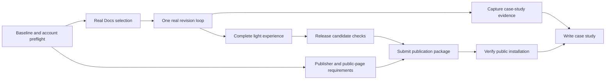

# yourIntelligent: execution and delivery plan

November 8, 2026 | Initial execution baseline | Owner: solo founder, assisted by Codex

## 1. Delivery commitment

Deliver two connected outputs: **a publicly installable Google Docs add-on** and **a product/design case study documenting the actual work and evidence**. Work starts with implementation, using the existing research, product decisions, and Figma designs. Further speculative design is not a prerequisite.

The founder wants delivery as soon as possible, has no fixed date, and has a Google account and Gemini test key ready. They can recruit students later. Do not ask again for these inputs or for a weekly-hours estimate before beginning. Public review timing remains an external dependency; distinguish a working test installation, submission, and verified public installation.

This is a small product. Use one repository, one sidebar, one provider, one owner, and a short delivery queue. The detail below is an execution reference, not a requirement to create a separate document for every task. No recurring meetings, additional staff, or parallel agents are assumed.

**First useful milestone:** in a real Doc, capture an exact passage, request feedback for one lens, revise manually, refresh locally, explicitly request a second reading, and finish. Then complete the remaining lenses, recovery, publication, and case study.

## 2. Source hierarchy and current inventory

| Source | Purpose | How to use it |
|---|---|---|
| User decisions in this conversation | Scope and priorities | Highest authority; especially light only, BYOK, $0 developer spending, no mandatory send confirmation |
| PRODUCT-PLAN.md | Audience, job, R1–R10, outcomes | Defines what user value must survive every change |
| DESIGN-PLAN.md v0.3 | Current experience and visual rules | Current Margin / Cut light direction supersedes older zine/Open Margin concepts |
| Current Figma journey and light showcase | Layout and component evidence | Implement the current states; component inventory is not automatically product scope |
| DEVELOPMENT-PLAN.md | Architecture and original DEV-01–10 tickets | Engineering baseline; verify external APIs and resolve outdated wording before copying |
| UX-RESEARCH-SYNTHESIS.md | Findings, assumptions, limits | Evidence boundaries for product claims and later evaluation |
| IDEATION.md | Concept history | Case-study background; not authority for expanding the release |
| This plan | Ordering, ownership, gates, delivery status | Coordinate execution and record completion evidence |

Inspected repository: planning/research files and `assets/design-tokens.css`; no application scaffold or package manifest yet. Existing Figma work includes a 13-state journey and Docs context. Designs are prepared examples, not implemented behavior or observed user outcomes.

Figma baseline: [journey](https://www.figma.com/design/cCYBiEtcT6Ex7aplARb4Vy/yourIntelligent?node-id=5-12659), [light showcase](https://www.figma.com/design/cCYBiEtcT6Ex7aplARb4Vy/yourIntelligent?node-id=11-3291).

### Reconcile before implementation

- Product-plan wording that credentials stay outside the client is too broad: a student key necessarily enters sidebar memory, then passes transiently to Apps Script. Never persist it or embed a publisher key.
- Refresh captures local text only. It never implicitly sends to Gemini. A subsequent explicit action sends the previewed passage and context.
- Render the question prominently before the supporting observation, as in the updated Figma. The provider schema may still contain observation/question fields in any order.
- Keep yourIntelligent as the product name; Margin / Cut is the design concept. Light only, no motion, DM Sans/Roboto, charcoal actions and restrained blue.
- Do not copy the exact model ID, API revision, endpoint shape, timeout option, scope assumptions, or publishing requirements from the older plan without checking current official documentation and the real account/runtime. These are feasibility checks, not promises.
- A second reading must have an explicit context contract. If only the new passage is sent, feedback must discuss that passage rather than claim a before/after comparison. Prefer that simpler contract for version one. True comparison would require previewing and authorizing both versions.

## 3. Scope contract

**Ship:** current-passage capture and preview; three lenses plus custom focus; optional context; session-only Gemini key; one grounded question/observation; direct student revision in Docs; local refresh; explicit second request; redirection; skip/finish; sample mode; useful errors; accessible light UI; public installation, help/privacy/support, and case study.

**Defer:** dark mode, saved conversations, persistent keys, automatic edits, rewritten prose, grading, instructor dashboards, multiple providers, payments, mobile, a separate app backend, contribution replay, and elaborate animation.

Sample mode must label both sample writing and prepared feedback and make zero provider calls. Real mode must never silently substitute prepared feedback when a provider fails.

The release must preserve student control: exact context, visible send action, contestable interpretation, no forced answer, and an easy exit. A model-quality check cannot prove psychological ownership or learning gains.

## 4. How orchestration works

The founder owns product judgments, publisher identity, account authorization, recruitment, and the public release decision. Codex prepares and implements the code, design translation, tests, release assets, evidence, and documentation within authorized work. Google controls review and account/platform restrictions. Gemini controls provider availability, limits, and account terms.

Work in one vertical slice at a time. Each slice includes the necessary UI, state, integration, and verification. Design the next slice only as needed while implementing the current one. A task is ready when its scenario, dependencies, and pass condition are clear. A task is done when its pass condition has evidence; screenshots alone cannot complete integration work.

Use these statuses: **Queued → Ready → Active → Verify → Done**; **Blocked** includes a named missing input and next action. Keep one main implementation task active. While a genuine account/review dependency blocks it, work on local verification, supporting pages, or the case study.

At the end of each meaningful work session, update this plan with the completed ticket, evidence path/commit, remaining failure, and exact next action. Update other plans only when a decision changes. Do not create separate issue-tracker tickets unless useful or requested.

## 5. Milestones and critical path

| Milestone | Observable result | Gate |
|---|---|---|
| M0: start ready | Source hierarchy, build queue, account ownership and deployment route understood | No unresolved foundational scope conflict |
| M1: core loop | Real selected passage produces real feedback; student revision can be reread | Selection accuracy, credential handling, and explicit send verified |
| M2: pilot candidate | All first-release controls, states, visual rules and recoveries work | Keyboard and real-host walkthrough passes |
| M3: submission ready | Versioned artifact, technical checks, public pages and listing complete | No critical correctness/privacy defects; actual submission requirements satisfied |
| M4: deployed | Public listing/install route works for another personal account | Public installation verified, not merely a developer test |
| M5: case study delivered | Publishable narrative links to actual design, code and deployment evidence | Claims match evidence and limitations are explicit |

M5 drafting runs during M1–M4. Public release and a complete case study are the finish line. A local mockup or Marketplace submission alone is incomplete.

## 6. Ordered work packages

### O-01 — Establish the implementation baseline

**Dependencies:** none. **Owner:** Codex; founder supplies account authorization when needed. **Maps to:** DEV-01.

Inspect repository instructions and Git state; preserve user work. Add TypeScript strict mode, esbuild, project-local clasp, lockfile, build/typecheck/test commands, and a local sidebar preview with a fake host/provider bridge. Keep generated upload output separate from source. Add ignore rules for credentials, local authorization, build output and dependencies. Define shared request/feedback/error contracts before connecting real services.

**Done:** clean install can build the upload artifact; server entry points survive bundling; local preview runs without an API key or network model call. Record exact commands in README. Avoid redesigning the existing Figma.

### O-02 — Verify publisher and provider feasibility early

**Dependencies:** account readiness, already confirmed. **Owner:** founder authorizes; Codex inspects/configures within scope. **Maps to:** DEV-02/04/09 prerequisites.

Check current official Google instructions for an Editor add-on, test deployments, Cloud-project linkage, scopes, account restrictions, review, and public-page/domain requirements. Check Gemini's available model/API, structured output support, quota/cost eligibility and terms for the test account. Check font licensing for bundled assets. Record tested choices in a small decision log.

**Done:** there is a feasible test route and a concrete public-submission checklist, with any no-cost hosting/domain limitation identified early. No automatic billing activation, purchased domain, paid model fallback, or unsupported free-service promise. The existing ready account/key does not eliminate these configuration checks.

**If blocked:** continue local work and public-page drafts; identify the exact account/configuration step. Do not silently change to a Chrome extension or unrelated web app.

### O-03 — Capture a real Docs passage

**Dependencies:** O-01 and test setup from O-02. **Owner:** Codex. **Maps to:** DEV-02–03.

Open the sidebar through the Editor add-on lifecycle. On open, do not read the document or call Gemini. Implement selected plain-text capture and preview, including partial ranges, Unicode, paragraph joining, active tabs, empty selection and unsupported content. No silent truncation or whole-document fallback. Keep the document adapter free of write operations.

**Done:** selected synthetic passages exactly match the preview in real Docs; changing sidebar focus does not silently change captured context; unsupported selections yield actionable recovery. Capture one screenshot and integration-check result. This is a technical feasibility probe: discard experimental code that does not meet the production contract.

### O-04 — Complete one real revision loop

**Dependencies:** O-03 and verified Gemini configuration. **Owner:** Codex; founder enters test key in the intended UI. **Maps to:** DEV-04–05.

Implement the depth lens first, masked session key entry, explicit Ask Gemini action, server request validation, sanitized errors, bounded provider request and output parsing. Preserve one observation/question and exact evidence-quote validation when present. Treat draft/context content as data. Add the initial duplicate guard and stale-response protection before live requests.

Render feedback tied to Passage 1. Let the student revise in Docs, capture Passage 2 locally, preview it, and explicitly request a second reading. Changing context/focus or ending a session invalidates late results. Forget key clears application references. No automatic retry after a timeout with uncertain outcome.

**Done:** demonstrate the full loop using synthetic text and a real provider response; outgoing content matches the authorized preview; no key or draft enters logs/persistent storage; no automatic document modification occurs. A mock response does not pass this gate.

### O-05 — Complete agency and all focus paths

**Dependencies:** O-04. **Owner:** Codex. **Maps to:** DEV-06; R1–R7/R10.

Add clarity, voice and custom focus, optional course context, correction of an interpretation, and the sample path. Implement Change focus, Skip question, Write in Docs, Finish, Another passage and Forget key consistently. Skip should permit writing without answering; it should not silently trigger another paid request. Another angle, if retained, is an explicit provider request with clear context.

**Done:** each lens completes the same real loop; custom direction affects the request; the student can reject feedback without explaining or accepting it. Every state offers an exit. The end state does not require a reflection or score. Sample mode is unmistakable and provider-free.

### O-06 — Apply the current design system and host behavior

**Dependencies:** O-03; finish alongside O-05. **Owner:** Codex, founder reviews the concrete result. **Maps to:** DEV-06.

Use the revised token CSS, DM Sans/Roboto, mono metadata, 300px width, 16px side padding, charcoal pill actions and limited blue. Make the reader question the focal heading. Translate Figma frames into semantic components: header, passage preview, lens choice, feedback, key field, primary/secondary controls and inline status.

Check long passages, long questions, wrapping, scroll, unavailable states, 44px targets, 2px focus, keyboard ordering, error/status announcements and zoom. Use real host screenshots to compare with Figma. Do not copy the showcase's disabled custom focus, session-preference switch, or send dialog as new product requirements. No motion or dark mode in this release.

**Done:** complete workflow is readable and operable in actual Docs, not only at a large preview size. Record important deviations required by the host and fix clipping/focus loss before polish elsewhere.

### O-07 — Harden boundaries and provider behavior

**Dependencies:** O-04–06. **Owner:** Codex. **Maps to:** DEV-07–08.

Complete nonce-ledger expiry/capacity/race behavior and request identity checks. Persist only bounded operational metadata if required; never keys, passages or feedback. Validate API input/output and render text safely. Test invalid/revoked keys, unavailable model, quota, malformed output, missing/incorrect quote, refusal, timeout, duplicate clicks, superseded requests and two documents/tabs.

Run a small synthetic model corpus covering each lens, ordinary experiences, disagreement, embedded instructions and requests for rewritten prose. Record prompt/model versions and failure classifications. Correct failures in the tested set; finite tests do not guarantee perfect coaching. Use deterministic mocks for routine tests and a small deliberate live check with the authorized account.

**Done:** technical verification matrix below passes; critical defects are resolved; unsupported cases are clearly explained. No completion claim based solely on passing typechecks.

### O-08 — Prepare public content and release artifact

**Dependencies:** O-02; final wording depends on O-07. **Owner:** Codex prepares, founder supplies publisher identity/support destination. **Maps to:** DEV-08–09.

Produce concise static product/how-to, installation, key setup, privacy/data-flow and support pages on a verified suitable no-cost route. Explain exact selection handling, transient credentials/content, operational metadata, provider processing and limits accurately. Check page URLs are publicly accessible and match listing information. Prepare icon/listing screenshots from the actual app, short description and review instructions.

Create a reproducible versioned release; tie code commit, artifact, prompt, model/configuration and deployment version together. Separate development and publication configurations. Prepare a previous-version restore procedure and a way to pause provider requests without affecting normal Docs editing.

**Done:** the package meets the current checked requirements and all public statements match implemented behavior. Support contact and publisher ownership are real, not placeholders. Case-study screenshots contain synthetic content and no keys.

### O-09 — Submit, address review, and verify deployment

**Dependencies:** O-07–08; founder's concrete release decision. **Owner:** founder owns publication; Codex performs authorized preparation/submission and fixes. **Maps to:** DEV-09–10.

Review the exact build, scopes, listing, data pages and visibility choice together. Confirm irreversible configuration only when needed and not already authorized. Follow the verified Google publication route, record submission status and respond to actual reviewer feedback. Re-run affected checks after changes; avoid broad unrelated rework.

**Done:** a second personal Google account installs through the public route and completes capture → feedback → manual revision → refresh → second reading → exit. Verify uninstall/reinstall and key re-entry. Record the public URL and deployed version. If review is pending, status remains submitted/pending, never deployed.

### O-10 — Deliver the case study and later evaluation

**Dependencies:** evidence collected throughout; final launch section after O-09. **Owner:** Codex drafts, founder approves personal narrative and recruits later.

Draft continuously: problem and audience; source findings and limits; product hypothesis; rejected automation approach; journey and iterations; transition from editorial zine to Margin / Cut; technical feasibility; BYOK tradeoff; implementation/testing; actual release; limitations and next questions. Include links to Figma and public installation, and selected actual screenshots.

The founder can recruit students later. Keep formal student evaluation deferred as requested; do not invent findings or make it an unannounced launch blocker. Recommend a small voluntary pilot once the technical release candidate is ready. If publication precedes evaluation, label it an initial release and report that outcome evidence is not yet available. Course rules and personal-content disclosure need consideration in recruitment materials.

**Done:** a coherent case-study artifact suitable for a portfolio, with editable source and clear evidence captions. If no portfolio destination is chosen, deliver a standalone Markdown/HTML artifact with assets rather than delaying completion. Add evaluation findings only after actual sessions.

## 7. Technical verification and release gate

| Area | Required evidence | Blocks release when |
|---|---|---|
| Context control (R1–R2) | Exact capture fixtures and real Docs checks; capture/refresh make no model call | Wrong/extra text is sent or preview is misleading |
| Coaching (R3/R5/R6) | Synthetic corpus and structured-output checks | Tested cases produce replacement assignment prose or unsupported claims without recovery |
| Agency (R4/R10) | Keyboard walkthrough of redirect, skip, finish | Accepting feedback or answering is required to continue/exit |
| Async state (R7) | Delayed/duplicate/changed-context tests | Old response is displayed as a reading of new text |
| Resilience (R8) | Provider/auth/selection failures in actual host | Normal writing is blocked or retries happen invisibly |
| Data handling (R9) | Log/persistence inspection and account-isolation check | Keys/raw content leak or statements contradict behavior |
| Visual accessibility | Actual-width/zoom/keyboard/status checks | Essential content/control cannot be read or used |
| Distribution | Independent-account installation and real loop | Only developer test setup works |

Run targeted tests for meaningful behavior and external boundaries. Do not add tests that merely restate CSS values or implementation internals. After relevant checks pass, move toward release; repeat only for new changes, failures or unresolved risks.

## 8. Risks, missing pieces, and responses

| Risk / missing item | Response and decision point |
|---|---|
| Exact Google publisher/Cloud configuration unknown | Inspect during O-02; account is ready, configuration still needs evidence |
| Exact provider availability/cost unknown | Verify adapter/model with test account; no paid fallback or invented free guarantee |
| Personal reflections conflict with provider data terms | Truthful onboarding, redacted/synthetic test material, verify applicable terms; adjust eligible use rather than promise privacy |
| Selection capture unreliable inside host | Time-box investigation; document failing cases; support reliable plain-text subset with clear errors |
| BYOK makes onboarding difficult | Clear key guide and no-key sample; later measure setup abandonment; do not add persistent storage to hide friction |
| Public pages/domain review requirement incompatible with $0 route | Identify early; present exact requirement and feasible choices before any expense |
| Founder support identity/contact missing | Supply by O-08, not a blocker to scaffold/integration |
| Review takes longer than implementation | Finish case-study draft and actual defects while pending; do not promise a publication date |
| Portfolio destination unspecified | Deliver standalone editable case study first; site publishing can follow |
| Usage outcomes unmeasured | State hypothesis/implementation evidence separately; recruit later through founder |
| Scope creep from Figma library | Treat unused component states as examples; add only features serving this release |

## 9. Operations after launch

Start with sanitized error categories and timings, version information, and a support route. Do not introduce content analytics or third-party tracking by default. Separate product research from operational logging. If ownership/confidence measures are collected later, define consent and retention before collection.

For leaked-content risk, wrong-context requests, or a serious coaching regression: pause model requests, identify affected version, fix and validate, then restore service. Document that the app cannot erase provider-held content, cancel every in-flight request, or replenish student quota. For ordinary service failure, show actionable status and preserve writing.

Record releases and known limitations. Recheck provider compatibility when changing model/API configuration; do not silently swap models. Rollback means returning to a known working version/configuration through the platform's supported procedure, verified during release preparation.

## 10. ASAP schedule and scope control

Use milestone order instead of invented calendar deadlines. First work block: scaffold plus publisher preflight. Next: real capture. Next: one real complete loop. Then finish the current design and all lenses, harden, submit, verify installation, and finish the case study.

Account readiness removes a known wait. The biggest early uncertainty is real Docs/provider integration; the biggest later wait is external review. After M1, use actual progress to forecast remaining effort. No additional planning cycle is required before coding.

If delivery slows, cut additional polish, unused component variants, extra marketing pages, and optional analytics. Keep correctness, explicit context/send, session credential handling, core agency controls, essential accessibility, release documentation and install verification.

## 11. Execution ledger

| Ticket | Initial status | Evidence / next action |
|---|---|---|
| O-01 | Done locally | TypeScript/esbuild/Vite scaffold, bundled sidebar, sample journey, 4 passing tests; see README |
| O-02 | Ready | Account and key available; inspect actual setup and official requirements |
| O-03 | Core standalone capture confirmed / edge cases open | Founder confirmed standalone capture + Gemini reading; selection/tab edge cases remain open |
| O-04 | Core loop confirmed in bound preview | Founder confirmed both Aion and Gemini revision loops. Standalone test and broader output evaluation remain open; see docs/LIVE-PROVIDER-CHECKLIST.md |
| O-05 | Queued | Build on one working loop |
| O-06 | Ready for implementation alongside slices | Current design plan/tokens/Figma available |
| O-07 | Active / deterministic hardening passes | 28 tests; stale capture/input preservation, structural paragraph boundaries, ledger failures and operator pause checked. Updated real-host selection and coaching corpus remain open |
| O-08 | Public pages live / listing assets and setup pending | John Phillip Custodio; LinkedIn support; jpsc@tuta.io confirmed; GitHub Pages product/privacy/terms/support URLs verified |
| O-09 | Queued | Needs concrete release package |
| O-10 | Working draft ready | CASE-STUDY.md distinguishes implementation evidence from unevaluated outcomes; screenshots/public release section pending |

Session handoff format: **completed and evidence; active task; blocker and owner; next exact action; any changed decision**. Keep this ledger accurate and concise as work progresses.

## 12. Skill application

Applied Dean Peters' **epic-breakdown-advisor** for thin end-to-end slices, **user-story-mapping** for preserving the complete student journey across releases, and **pol-probe** for narrow integration feasibility checks. Used existing context rather than repeating the workshop intake. The FigJam-specific generate-project-plan skill was inspected but not applied because this deliverable is an executable repository plan, not a requested FigJam workshop board.

The plan defines future work. No application code, account configuration, deployment, test results, or student outcomes are claimed complete by its creation.

### Implementation update — November 8, 2026

First slice implemented on `codex/first-working-slice`. Local sample navigation, all lens choices, manual sample revision/refresh, redirection, session key UI, and finish are present. Provider calls are explicitly disabled. Apps Script menu/sidebar and selected-plain-text adapter build successfully. Four deterministic selection/journey tests pass. Real host capture, live Gemini, deployment and visual browser validation remain pending. Clasp sign-in is absent on this machine. Fonts are bundled locally; no external font request is required. Dependency overrides address reported tooling vulnerabilities; clasp version command and build checks pass, but authenticated upload remains untested.

### Docs integration setup — November 8, 2026

Google clasp authorization completed and Apps Script API enabled by founder. Created the standalone development project and pushed Code.js, Sidebar.html and manifest. Eight local tests pass, including the server adapter. Created a synthetic test Doc and opened Editor Add-on test configuration; file-picker automation failed, so founder handoff is pending. Actual capture verification remains pending. No live provider request has been implemented.

Host verification update: Editor add-on test is saved and executed; founder authorized document/sidebar access. Menu and rendered sidebar verified. Fixed Apps Script HTML handling of bundled template literals. Capture RPC still fails before returning content; O-03 remains active. Next action: inspect capture call failure with a safe diagnostic category, authorization/test context, and an isolated RPC probe. Eight local tests pass.

### Capture diagnostic outcome

The founder confirmed exact paragraph capture in a private-browser document-bound preview after native top-level server entry points and whole-paragraph handling were implemented. Ten local tests pass. A separate repeatable bound-preview build exists; it is a development target, not public distribution. O-03 has a working core capture path but remains active for standalone add-on verification and remaining live selection/tab cases. In-app browser authorization rejection remains unresolved. Next implementation work is the real Gemini adapter and explicit-request loop, with standalone publication prerequisites retained in parallel. No psychological/user-study outcomes are claimed.

### Provider slice - November 9, 2026

Founder selected Aion Labs for synthetic testing only; Gemini remains the release provider. Second readings assess only the refreshed passage, with no earlier draft sent or comparison claim. Request implementation and deterministic tests are ready; actual live responses and standalone/public installation remain unverified. Session keys are never persisted; only nonce/timestamp duplicate-request metadata is stored. Next gate: founder performs one deliberate request using an actual key in the masked sidebar field.

### First live Aion response - November 9, 2026

Founder reported one observation and one question appearing after an explicit Aion request in the document-bound preview. This establishes a first live request/response, not output quality, a complete revision loop, Gemini acceptance or public deployment. O-04 remains active until manual edit, refresh and the second explicit reading are confirmed. Next: verify refreshed-only behavior in the host, then switch the development preview to Gemini for separate acceptance.

### Full Aion loop confirmed - November 9, 2026

Founder confirmed manual revision, local refresh and a second explicit Aion reading addressed only the refreshed passage without a comparison claim. Rebuilt the bound preview using the normal Gemini configuration for the next provider acceptance check. No application-code change was needed. Broader coaching-quality evaluation, Gemini success and standalone/public installation remain open.

### Gemini loop confirmed - November 9, 2026

Founder confirmed both Gemini readings worked in the bound preview, following the requested manual revision and refresh sequence. O-04 core loop now has founder-reported real-host evidence for the shipping provider. Rebuilt the standalone Gemini add-on for a fresh Editor add-on test using the native entry points that fixed the bound preview. Standalone install/authorization remains a separate gate. No public release or student outcomes are claimed.

### Standalone test and release-content slice - November 9, 2026

Founder confirmed standalone capture + Gemini reading. Prepared docs/RELEASE-PACKAGE.md, product/setup/privacy/terms/support source under docs/public, and CASE-STUDY.md. Publisher confirmed as John Phillip Custodio; LinkedIn is the requested student support destination. OAuth still requires an email address; no personal email is assumed public. Hosting, listing assets, Cloud/publisher setup, remaining hardening and independent-account installation remain open. Current Google publishing/OAuth/listing documentation was checked. No public deployment or review submission was made.

### Public website published - November 9, 2026

Founder confirmed jpsc@tuta.io for Google support/contact and GitHub Pages if free. Public repository eligibility verified. Built four static Margin / Cut pages with bundled fonts, no browser JavaScript, and truthful development availability. Published website-only subtree at codex/public-pages through existing browser Pages settings. Deployment succeeded; product, privacy, terms, support, CSS and font probe returned HTTP 200. Desktop and narrow layout reviewed; no narrow overflow. `npm run check` passes all 19 tests, typecheck and app build; `npm run build:site` checks page headings/navigation/assets. No paid setup activated. Next: remaining app hardening and listing assets, then inspect Google Cloud/OAuth/Marketplace setup using the confirmed identity/contact and live URLs. Add-on public installation remains unverified.

### Hardening slice - November 9, 2026

Fixed delayed capture overriding navigation and stale completion re-rendering unsaved fields; cleared old context on Another passage; replaced paragraph-wrapper identity with structural paths; retained controlled selection-size guidance; added focus/wrapping improvements, strict request-ID type and project-level provider pause. All 28 tests, typecheck and standard/bound Gemini builds pass. Local browser sample checked at 300px: no overflow with unbroken text, 44px visible buttons, heading-to-control keyboard focus. Uploaded the standard Gemini build to standalone and prepared the same bound update. Updated capture implementation still needs real-host edge-case acceptance. See docs/HARDENING-RESULTS.md. Next after that check: listing graphics and Google Cloud/OAuth setup inspection.
