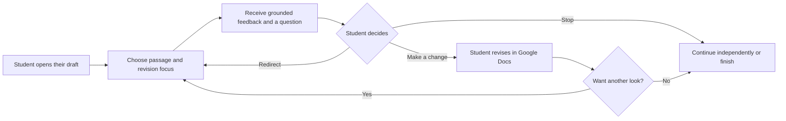

# yourIntelligent: product and design plan

Execution sequence, milestone gates, ownership, and delivery tracking are in [ORCHESTRATOR-PLAN.md](ORCHESTRATOR-PLAN.md).

Version 0.2 | November 7, 2026 | Revision-first, solo delivery

## 1. Product decisions and status

**Confirmed by the founder**

- Audience: college/university students.
- Initial writing: course reflections and personal essays.
- Course context: English courses and other university courses requiring personal reflection.
- Initial use case: revising existing student writing, especially at the point where students might otherwise ask AI to automate revision. The prevalence of this behavior comes from founder context and remains to be validated.
- Experience: a playful writing partner that helps students explore their ideas.
- AI role: questions and feedback; students write all assignment prose.
- Intended home: Google Docs.
- Eventual deliverables: a product/design case study and a working extension intended for deployment.
- User testing comes later. This stage defines the product and design.
- Delivery: solo project, as soon as possible. Prioritize a small working revision loop and document design decisions as it is built.
- Distribution and funding confirmed during engineering planning: public installation for students using their own Google accounts; students provide Google Gemini API keys; developer spending target $0. See [DEVELOPMENT-PLAN.md](DEVELOPMENT-PLAN.md).

**Working proposals** in this plan are design decisions to review, not validated customer facts. Audience values, pain points, behavior, and emotions are hypotheses. No participant quotes or usage statistics have been invented. The technical implementation and deployment have not started.

Existing context: [initial ideation](IDEATION.md), [research synthesis and assumption register](UX-RESEARCH-SYNTHESIS.md), and [design plan and editorial visual system](DESIGN-PLAN.md).

## 2. Product definition

**Pitch:** Own the writing you create with AI. Make writing with AI fun and interactive.

**Product description:** A playful AI revision partner inside Google Docs that helps university students improve course reflections and personal essays while keeping decisions about meaning, voice, wording, and final changes with the student.

**Promise to design toward:** Help me revise my writing while keeping it mine.

**Ownership and agency in the design:** Students choose what to revise, judge the feedback, decide what they mean, write the changes, and decide when to stop. Total ownership and agency are the founder's design ambition, not a guaranteed psychological outcome or a legal claim. Preserve the confirmed questions-and-feedback-only AI role.

**Primary job:** When I have a draft reflection or personal essay that needs revision, help me understand what could improve and choose changes I can make myself, so the result communicates my meaning and still feels like my writing.

**First useful moment:** A student receives specific feedback on a selected passage and identifies a revision they want to make. Clicking through onboarding or requesting feedback does not by itself establish value.

**Useful session outcome:** The student develops or revises a passage they consider worthwhile and can explain the decision behind it. They can also reasonably decide that the feedback does not fit and continue independently.

## 3. Audience

### Working primary persona: Reflective Riley

This is a proto-persona for design alignment. The name is fictional; the needs below require later validation.

| Basic info | Working definition |
|---|---|
| Education | University undergraduate; year level remains open |
| Major | Across majors: students enrolled in English or other courses requiring personal reflection; an English major is not required |
| Writing situation | Revising a course reflection or personal essay connecting an experience to an observation, interpretation, or course idea |
| Starting point | Has a student-written passage or draft that needs revision |
| Help sought | Specific revision feedback while retaining their own voice, reasoning, and control over changes |
| Device/context | Proposed desktop Google Docs experience; actual device and account availability must be confirmed |
| AI experience | May have used general-purpose AI, but the design should not require prompting expertise |
| Age/location | Not specified; unnecessary to invent for this design stage |

### Values and lifestyle: hypotheses

| Dimension | Working assumption | Design implication |
|---|---|---|
| Authenticity | Wants the reflection to sound like something they would say and stand behind | Ground help in their language and let them contest interpretations |
| Competence | Wants to feel capable of developing an idea | Make the next move understandable; avoid unexplained evaluation |
| Efficiency | Balances writing with other coursework and commitments | Short, optional interactions; immediate access to writing |
| Autonomy | Wants control over depth, direction, and pace | Offer custom focus, skip, redirect, and stop controls |
| Exploration | May enjoy discovering an unexpected connection | Optional playful lenses with clear purposes |
| Privacy | May not want to expose personal experiences or unfinished thoughts | Use selected passages and optional context; explain actual data handling |

Do not assume students share a single lifestyle, personality, income, or motivation because they attend university.

### Goals, values, and motivations

| Type | Desired outcome | Product response |
|---|---|---|
| Immediate | Understand what to revise and why | Identify one specific opportunity in the selected passage |
| Assignment | Revise a reflection to address the prompt more effectively | Let students supply the prompt and select what they want to work on |
| Emotional | Feel capable and proud of their contribution | Surface concrete decisions and development without automatic praise |
| Expressive | Preserve a voice that feels like their own | Offer questions and observations; students compose the text |
| Practical | Finish with manageable effort | Support one useful turn at a time and a clear exit |
| Longer term | Become more comfortable developing and revising ideas | A possible benefit to investigate, not an established promise |

### Pain points and behavior: hypotheses

| Situation | Possible pain | Possible current behavior | Design opportunity |
|---|---|---|---|
| Entering revision | Has a draft but does not know where to start revising | Rereads it, changes wording, or asks AI to revise it | Make a passage and revision goal easy to choose |
| Developing | Describes what happened but cannot articulate why it matters | Adds detail or repeats the same point | Help explore interpretation, significance, or change |
| Seeking help | Feedback is generic or feels evaluative | Asks a friend, tutor, or chatbot; decides whether advice fits | Provide grounded, contestable feedback |
| Automating revision | A revised passage may no longer express their intended meaning or voice | Asks AI to rewrite, then reviews whether to keep the result | Help the student evaluate and make the change themselves |
| Finishing | Cannot judge whether the reflection communicates their intended meaning | Keeps tinkering or submits with uncertainty | Offer an optional focused review against their stated intent |

These current behaviors have not been observed in user research. Preserve this label in the case study until evidence replaces it.

### Other actors

- **Student:** primary user and decision-maker about the writing.
- **Instructor:** influences the assignment's purpose and permitted help; is not the default audience for private interactions.
- **Writing center/tutor:** possible collaborator or referral source, not replaced by an assumed AI capability.
- **University administrator:** may affect installation on managed accounts.
- **Buyer/funder:** unresolved. Student use does not establish that students will pay.

## 4. Journey

### Proposed adoption journey

| Stage | Student action / touchpoint | Experience hypothesis | Product responsibility | Signal to evaluate later |
|---|---|---|---|---|
| Discover | Encounters a demo through a peer, course, or writing support channel | Curious but unsure what makes it useful | Explain the coaching-only role with a concrete example | Can describe the product accurately |
| Decide | Reviews how it works and what document content is used | Wants help without giving away the assignment | Show the scope of help and truthful access information | Chooses to try it on suitable material |
| Enter | Opens the add-on in Google Docs | Wants little setup | Support a sample or an existing passage | Reaches a relevant first question |
| Use | Evaluates feedback and revises their own text | May become engaged or frustrated | Keep feedback grounded, optional, and easy to redirect | Makes and explains a useful revision |
| Return | Starts another reflection | Wants assistance when needed | Make the loop familiar without dependence on a long chat | Voluntarily returns for another suitable task |

Acquisition channels above are proposals, not confirmed partnerships or an authorization to contact anyone.

### Writing journey: proposed experience

| Stage | Student goal | Likely difficulty to investigate | yourIntelligent's role |
|---|---|---|---|
| Select | Identify a passage needing revision | Unsure where to start | Preview the student's selected text |
| Set intent | Choose what should improve or remain theirs | A vague request such as "make it better" | Offer clear revision lenses and a custom focus |
| Evaluate | Understand and judge a revision opportunity | Advice is generic or steers the meaning | One grounded observation and a question, with redirection controls |
| Revise | Make an intentional change | Temptation to hand the change to the AI | Leave room for student writing directly in Docs |
| Review | Decide what the piece communicates | Unsure whether intent comes through | A limited review against student intent and supplied context |
| Leave | Finish the session or continue independently | Coaching becomes endless | Clear stop; optional recognition of what changed |

The flow is iterative and starts with an existing student-written passage. A student can choose another passage, change their mind, or finish without taking the advice. Blank-page ideation is a later possibility rather than the first release's main task.

## 5. Task analysis

**Overall task:** Revise a student-written course reflection or personal essay while retaining control of its meaning, voice, and final form.

This section describes student work, not the interface's navigation.

### 1. Identify a revision goal

1. Read the assignment or identify the personal writing purpose.
2. Identify the audience, intended depth, and any relevant constraints.
3. Decide what needs attention in the existing draft and what should stay intact.

**Output:** A working focus. It can change later.

### 2. Select the writing to work on

1. Read the relevant draft passage.
2. Select a passage that needs attention.
3. Confirm the selected text and optionally explain its intended meaning.

**Output:** Student-written text and a working revision focus. No minimum word count or polished draft requirement.

### 3. Evaluate revision feedback

1. Choose a focus: clarity, reflective depth, voice, or a custom intention.
2. Read a specific observation and question grounded in the passage.
3. Decide whether it fits; reject or redirect it if needed.
4. Decide what to change, if anything, and why.

**Output:** A student-endorsed next writing move. This is the central design focus.

### 4. Develop and revise the writing

1. Write or revise the passage in Google Docs.
2. Connect observations to their interpretation or relevant course ideas.
3. Read the passage and check whether it expresses their intended meaning.
4. Seek another round of help only if useful.

**Output:** A developed passage, including any deliberate change of mind.

### 5. Evaluate and finish

1. Check whether the reflection addresses the intended focus and assignment.
2. Identify remaining gaps and choose which to revise.
3. Optionally describe an important change and why it mattered.
4. Stop, continue independently, or return later. Submission remains in the student's existing workflow.

**Output:** Writing the student can explain and decide is ready for its intended use.

### Task support boundaries

The student chooses the experience, interpretation, argument, language, and final decision. AI can ask grounded questions, identify possible reader interpretations, and invite checks against supplied context. It does not supply a finished thesis, outline, paragraph, or rewrite. Reflection need not require intimate disclosure; ordinary experiences are valid material.

## 6. Core services

| Service | Student need | Inputs | Product behavior | Result | Priority |
|---|---|---|---|---|---|
| **Choose my focus** | Get relevant help without composing a long prompt | Student text, optional assignment context, chosen lens or custom focus | Preview the selected text and let the student define the kind of help | A scoped request the student controls | First version |
| **Help me revise** | Understand a specific revision opportunity | Scoped request and current passage | Give one grounded observation plus a question; allow clarification, another angle, or redirection | A possible change the student evaluates | First version |
| **Read my revision** | Understand whether meaning comes through | Student-selected revised passage and optional stated intent | Offer one grounded observation or question tied to that intent | Student chooses the next revision or decides to stop | First version |
| **Notice my development** | Recognize a meaningful contribution | Student-selected before/after passages and optional self-explanation | Show a factual comparison; let students correct any interpretation | Optional reflection on their work | Later addition |

Redirection, skip, stop, and independent writing are part of every service, not premium or later features.

## 7. Playful interaction concept

**Personality:** Curious, warm, specific, and lightly playful. Treat students as capable authors. Avoid a grading voice, forced cheerfulness, or a dependent AI character.

### Three candidate lenses

| Lens | Purpose | Example question style |
|---|---|---|
| **Find the thread** | Clarify meaning and connections | "How does this experience connect to the lesson you name at the end?" |
| **Go a layer deeper** | Develop reflective depth | "What changed in your understanding after that moment?" |
| **Keep it me** | Check intended voice | "Which phrase here feels least like how you would explain this experience?" |

Also offer **My own focus**. Lens names and examples are design copy, not participant quotes. Questions must fit the student's actual text; a preset lens does not justify introducing an experience or conclusion the student never supplied.

### Interaction loop

### Worked scenario

Student draft: "Our group project taught me that communication is important. I will communicate better next time."

The student selects the passage and chooses **Go a layer deeper**. Feedback observes that the passage names a lesson but does not yet describe what led to it, then asks, "Which moment in the project changed how you think about communication?" The student can reject that direction, describe their intention, or revise the passage themselves. They then reselect the revision and request another reading if useful. The partner discusses the actual change without supplying replacement prose.

The AI does not infer a diagnosis, declare the group's motives, or write the incident for the student. A personal revelation is never a requirement for progress.

## 8. First version and release slices

The first release should complete a small useful loop: select an existing passage, choose a revision focus, evaluate feedback, revise, review, and leave.

| Slice | Start | Focus | Explore | Revise | Review / finish |
|---|---|---|---|---|---|
| **Design prototype** | Existing student draft or clearly identified sample | Passage preview and three revision lenses/custom focus | Representative grounded feedback and question | Demonstrated return to writing | Feedback and stop states |
| **Working pilot** | Read a selected passage in Docs | Student controls what is sent | Real model-generated question with failure handling | Student writes directly in Docs | Explicitly refresh selection for review; stop anytime |
| **Deployment candidate** | Installation and truthful onboarding | Stable context selection and settings | Quality controls, limits, recoverable errors | Reliable behavior during document changes | Support, data controls, monitoring and release process |
| **Later possibilities** | Optional saved preferences | Additional lenses if useful | More tailored exploration | Optional session continuity | Contribution reflection / replay if supported by later evaluation |

### Scope choices for the first working version

- A desktop sidebar centered on selected text.
- Optional assignment/context field, not a required intake questionnaire.
- Three lenses plus custom focus.
- One main question or observation at a time.
- Explicit reselect/refresh after a revision so the reviewed text is clear.
- No automatic document edits. All assignment writing happens through the student's normal editing.
- A small, recoverable session; no need for cross-device history at first.

Full drafting, rewrites, grading, plagiarism detection, source discovery, instructor dashboards, social feeds, and a mobile client sit outside this release. These exclusions keep the product aligned with the founder's purpose and make the first implementation tractable.

## 9. Information architecture and screen inventory

Google Docs remains the writing surface. The sidebar is a companion workspace with four main areas: **Current passage**, **Focus**, **Question/feedback**, and **Session controls**. A long freeform chat transcript is not the primary interface.

| State | Content and primary action | Important alternative |
|---|---|---|
| First open | Concise explanation of coaching, text use, and how to begin | Try a sample or close |
| No selected text | Ask the student to select part of their draft | Use a sample; continue without the partner |
| Passage ready | Show the exact passage and optional context | Change passage |
| Focus selection | Three lenses and custom focus | Leave without requesting feedback |
| Request pending | Clear working state | Continue writing; ignore a late result if superseded |
| Feedback ready to evaluate | One observation and question with its source passage | Another angle, redirect, or stop |
| Student writing | Quiet state that leaves space to work | Request help again |
| Revision ready | Refresh selection and optionally state intent | Start a new focus instead |
| Feedback ready | One specific observation/question | Disagree, redirect, finish |
| Failure/limit | Plain explanation and recoverable action | Keep writing without the tool |

Design all states for keyboard access, visible focus, readable text, and reduced motion. A playful identity should remain usable in a narrow sidebar and under ordinary coursework pressure.

## 10. Product behavior requirements

| ID | Requirement | Acceptance condition for implementation |
|---|---|---|
| R1 | Student contribution comes first | Without student material, show a neutral invitation or clearly identified sample; do not generate the student's topic or position |
| R2 | Student controls context | Show what passage will be used; allow replacement and optional context; do not silently send the full document |
| R3 | Help is scoped and grounded | Feedback refers to supplied text and chosen focus, with one primary next question or observation |
| R4 | Agency is usable | Skip, redirect, custom focus, and stop remain available without requiring an explanation |
| R5 | Assignment prose remains student-written | No insert/rewrite action; model instructions, output structure, and evaluation address requests for finished assignment text |
| R6 | Feedback can be wrong | Frame interpretations as interpretations; accept student correction without arguing for compliance |
| R7 | Context stays understandable | On a new selection or request, distinguish prior feedback from the newly selected text; discard superseded responses |
| R8 | Failure preserves the writing task | Errors, denied access, timeouts, or exhausted usage never block normal document editing |
| R9 | Student content is handled deliberately | Decide and implement actual collection, retention, deletion, and model-provider handling before describing them in onboarding |
| R10 | Session completion is optional | Students can finish without completing a reflection card or accepting advice |

Output checks can reduce unsuitable AI responses; finite checks cannot prove the model will never violate the coaching boundary. The deployed behavior needs evaluation and a way to handle failures. This is an implementation requirement, not user testing performed now.

## 11. Technical direction and deployment path

### Recommended starting approach: Google Docs Editor add-on

Google documents customizable Editor add-ons built in Apps Script for desktop editors, with HTML-based interfaces. A Docs sidebar is a credible starting point for this focused experience. Larger-scale runtime needs should be revisited if the product grows. [Google add-on types](https://developers.google.com/workspace/add-ons/concepts/types), [dialogs and sidebars](https://developers.google.com/apps-script/guides/dialogs).

Document selection APIs expose the active user's selected range and can return null. Verify their behavior in the chosen add-on context, including partial selections, active tabs, and changes of focus, in a short technical spike. [Document reference](https://developers.google.com/apps-script/reference/document/document#getSelection()).

**Proposed architecture:** Docs sidebar -> Apps Script document/context adapter -> authenticated server-side model request -> structured coaching response -> sidebar. Credentials stay outside the client. The document adapter reads only approved context for this experience and does not edit assignment text. Choose whether a separate backend is needed after the spike and expected usage are known.

**Explicit request model:** Capture context when students ask for help; refresh it when they request another reading. Continuous keystroke monitoring and inline overlays are not prerequisites for this design.

### Technical spike deliverables

1. Open a sidebar in a test document.
2. Reliably retrieve and preview a selected text passage in the intended add-on context.
3. Handle no selection, partial selection, active-tab changes, and selection loss on sidebar focus.
4. Complete one authenticated model round trip without exposing credentials.
5. Verify stale-response handling and that writing remains available during failures.
6. Document actual scopes, provider data handling, latency, quotas, and cost for this request pattern.

The spike can use fallback reselection or manual passage input while documenting the integration limitation. Do not present fallback copy/paste as the finished Google Docs interaction.

### From working pilot to deployment

Publishing uses Google Workspace Marketplace. Google distinguishes public publication, which undergoes review, from domain-private publication. Its current guide requires a standard Google Cloud project and a versioned add-on; publication visibility must be chosen carefully because the saved choice is not changeable. A private Marketplace listing means a specific domain, not an arbitrary invite-only group of personal accounts. [Publishing guide](https://developers.google.com/workspace/add-ons/how-tos/publish-add-on-overview).

Specify least-permissive scopes; whether OAuth verification is required depends on the scopes and publication circumstances. [Editor add-on scopes](https://developers.google.com/workspace/add-ons/concepts/editor-scopes).

Before release, resolve publisher/account ownership, target audience, school-account access, model usage budget, data handling, support contact, and operational monitoring. Prepare a release checklist around the actual implementation and current requirements. This plan does not publish anything or choose irreversible publication settings.

## 12. Product strategy and practical viability

**Positioning hypothesis:** A playful, student-directed AI revision partner for reflective writing, with feedback that supports student decisions inside the writing environment.

**Alternatives to investigate later:** writing alone, a peer reader, a writing-center session, generic reflection prompts, or a general-purpose chatbot configured as a coach. This is an alternatives list, not a completed feature comparison or a claim of competitive advantage.

**Why a student might choose it:** Less need to invent prompts, feedback tied to the passage being written, and clear control over the interaction. These benefits must be demonstrated in the eventual product and evaluated later.

**Initial distribution hypothesis:** A small voluntary university pilot, introduced through an accessible reflection-heavy course, student group, or writing-support context. No outreach or institutional endorsement is assumed.

**Business model:** Open. For the first release, students provide their own Google Gemini API keys and use their own provider quota/billing; developer spending target is $0. A paid checkout is outside this release. BYOK adds onboarding effort and limits the initial audience to students able to configure a key. No market size, price, or willingness-to-pay figure has been established.

## 13. Success measures for later evaluation

| Layer | Proposed measure | Why it matters |
|---|---|---|
| First value | Student identifies a useful revision after grounded feedback | Closer to value than counting generated questions |
| Core outcome | Student develops/revises a passage they find worthwhile and can explain the decision | Connects assistance to their contribution |
| Agency | Student can redirect and evaluate help, including reasoned acceptance or rejection | Avoids treating compliance as success |
| Enjoyment | Student reports curiosity or enjoyment with concrete examples | Tracks the playful product promise |
| Effort | Interruption, repeated unhelpful turns, and abandonment | Reveals when the interaction becomes a burden |
| Return value | Voluntary reuse on another relevant assignment | Separates a pleasant demo from practical usefulness |
| Operating quality | Failed requests, context errors, inappropriate drafting, latency, and cost per useful session | Supports a deployable service |

No numerical targets are asserted before a baseline or prototype exists. Later evaluation should keep ownership, capability, confidence, and enjoyment separate. User testing is deferred as requested; the existing research memo retains its proposed study plans.

## 14. Deliverables

### Two final deliverables

**A. Product/design case study**

Tell the story of the problem, evidence boundaries, product choices, design evolution, implementation tradeoffs, and eventual evaluation. Preserve the distinction between a hypothesis, a design decision, and a finding. Add test results only after tests occur.

**B. Working Google Docs extension intended for deployment**

Deliver an installable experience for the selected distribution route, with a real coaching loop, recoverable failures, documented data handling, operating limits, support, and release instructions. A clickable mockup or script tied to one demo document does not fulfill the eventual deployable-product goal.

### Supporting deliverables and completion criteria

| Deliverable | Contents | Done when | Current status |
|---|---|---|---|
| Research foundation | Sources, assumptions, and limitations | Evidence and inference are distinguishable | Existing memo |
| Product brief | Promise, audience, job, scope, measures | Core choices are coherent and remaining decisions visible | Drafted in this plan |
| Proto-persona | Goals, context, values, pains, behavior | Assumptions are explicit and relevant to design | Drafted in this plan |
| Journey and task analysis | Adoption, writing stages, student work | Start, iteration, and finish are covered | Drafted in this plan |
| Story map / release scope | A complete loop across prototype, pilot, deployment | Each release delivers a useful experience | Drafted in this plan |
| Interaction specification | Services, states, example loop, behavior rules | Main path and recovery paths are defined | Initial specification here |
| Concept alternatives | 2-3 approaches to the sidebar interaction | Tradeoffs and selection rationale are documented | Next design work |
| Wireframes and clickable prototype | Sidebar states in Docs context | Core loop, redirection, and failure can be walked through | Planned |
| Visual and content system | Type, color, spacing, controls, motion, tone | Playful identity works within accessible narrow-sidebar constraints | Planned |
| Technical spike | Integration and model feasibility evidence | Key uncertainties have concrete answers | Planned |
| Implemented pilot | Real selected-text coaching loop | Main and failure paths work with real Docs content | Planned |
| Later evaluation and iteration | Observations, outcomes, changes | Claims are tied to actual evidence | Deferred |
| Deployment package | Publisher setup, scopes, versioning, installation, support and data documentation | Actual route's requirements are met | Planned |
| Case study | Design narrative with links, artifacts, limitations and outcomes | A reader can follow decisions and inspect the delivered product | Planned |

## 15. Solo work sequence: shortest path to a useful product

| Phase | Work | Exit condition | Responsibility |
|---|---|---|---|
| 1. Specify the revision loop | Use one English-course reflection scenario and sketch the few sidebar states | Selection, feedback, redirection, revision, and finish are concrete | Solo founder, assisted by Codex |
| 2. Prove the integration | Build a narrow Docs selection-to-model-to-feedback spike | One real selected passage produces feedback inside Docs | Solo founder, assisted by Codex |
| 3. Complete the first useful slice | Add three focus choices, custom focus, refresh, error recovery, and stop | The complete revision loop works on real text | Solo founder, assisted by Codex |
| 4. Polish and document | Apply the playful identity and accessible interactions; capture decisions and implementation tradeoffs | Cohesive pilot and an honest case-study draft | Solo founder, assisted by Codex |
| 5. Evaluate later | Run the deferred user evaluation and revise | Evidence supports continue/change decisions | Solo founder |
| 6. Prepare distribution | Complete actual publisher, account, data, operating, and support requirements | Selected distribution route is ready | Solo founder, assisted by Codex |
| 7. Release and finish the case study | Publish through the chosen route and report actual outcomes | Delivered product and accurate case study | Solo founder |

**First milestone:** Select a paragraph in Google Docs, choose a revision focus, receive one specific observation and question, make a student-authored revision, and request another reading. This is the ASAP target before broad feature work.

**Solo scope discipline:** Use one sidebar, one passage at a time, one response format, and a small session. Keep contribution replay, saved histories, a separate dashboard, elaborate onboarding, and additional writing genres for later. Document the case study as decisions happen; do not require a polished case study before implementing the first slice.

**Scheduling:** ASAP means work in this order with the smallest useful scope. There is no invented calendar commitment because available hours, engineering familiarity, account setup, and review turnaround are unknown. A working pilot and public publication are separate milestones; external publication timing is not a guaranteed consequence of finishing code.

## 16. Decision log and remaining clarifications

| Decision | Status |
|---|---|
| University students | Confirmed |
| Course reflections and personal essays | Confirmed |
| English and other university courses requiring personal reflection | Confirmed |
| Revision of existing student writing as the first use case | Confirmed |
| Playful writing partner | Confirmed |
| Questions and feedback; student writes all prose | Confirmed |
| Case study + working extension intended for deployment | Confirmed |
| Define audience by course/writing situation across majors | Confirmed by course-based context |
| Start with a narrow desktop Docs sidebar | Proposed |
| Three lenses + custom focus | Proposed |
| Selected-text, explicit-request interaction | Proposed pending technical spike |
| Initial course context | English and other reflection-requiring courses confirmed; specific pilot course optional later |
| Team and deadline | Solo; ASAP |
| Engineering familiarity and available hours | Open; does not block design and scope decisions |
| Public Marketplace versus domain-private distribution | Public student distribution confirmed |
| Model provider and funding | Student-provided Google Gemini API keys; developer spending target $0 |
| Hosting, retention and persistence | Apps Script and session-only data recommended in development plan; actual implementation/provider handling to verify |
| Business model and long-term funding | Open |

No additional clarification is needed to design the first revision loop. Distribution, provider and developer budget are now confirmed. Publisher account setup and release documentation remain implementation inputs. Do not re-ask the confirmed audience, writing task, team, deadline, provider, or funding.

## 17. Skill provenance

Applied installed skills from Dean Peters' [Product Manager Skills](https://github.com/deanpeters/Product-Manager-Skills): [proto-persona](https://github.com/deanpeters/Product-Manager-Skills/tree/main/skills/proto-persona), [customer-journey-map](https://github.com/deanpeters/Product-Manager-Skills/tree/main/skills/customer-journey-map), [user-story-mapping](https://github.com/deanpeters/Product-Manager-Skills/tree/main/skills/user-story-mapping), and [prd-development](https://github.com/deanpeters/Product-Manager-Skills/tree/main/skills/prd-development). Used their structures to create a provisional product/design brief; this is not represented as a validated persona or completed research process. Source skills identify their license as CC BY-NC-SA 4.0.

### Confirmed implementation decisions - November 9, 2026

Gemini remains the release provider. Aion Labs is restricted to a synthetic document-bound development test build. Each explicit reading assesses only the current captured passage, chosen focus and optional context; a second reading sends no prior draft and makes no comparison claim. Refresh remains local until the student explicitly sends. The API key stays in sidebar memory and is never persisted by the app. See docs/LIVE-PROVIDER-CHECKLIST.md for implementation evidence and pending live acceptance.
